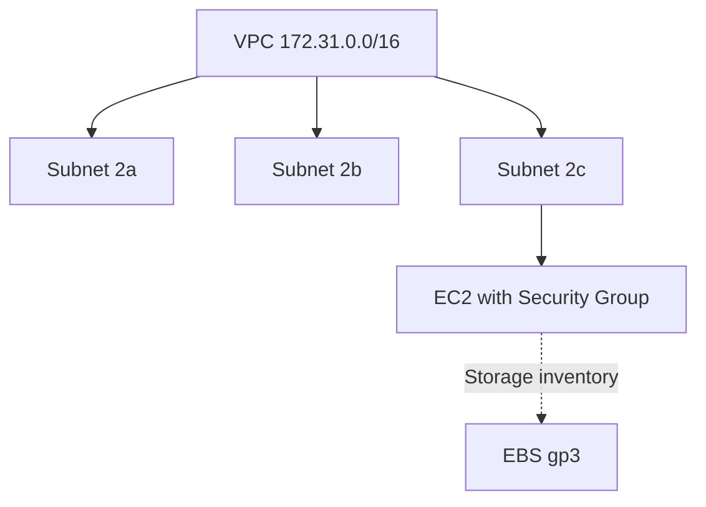

# AWS EC2 Network Security Lab

Hands-on cloud networking and security configuration portfolio project.

## Environment
- AWS Ohio (us-east-2), default VPC 172.31.0.0/16, three subnets across three availability zones.
- EC2 t3.micro in us-east-2c, running with 3/3 status checks passed.
- EBS gp3 volume: 100 GiB, 3000 IOPS, 125 MiB/s throughput.

## Architecture

## Security group analysis
| Port | Observed configuration | Recommendation |
|---|---|---|
| 22 SSH | Restricted to administrator IPv4 /32 | Use keys or Session Manager |
| 80 HTTP | Public in instance view | Close unless required |
| 443 HTTPS | Public in instance view | Restrict administrative dashboard access |
| 1514 TCP | Public in some edit screens | Restrict to trusted agents |
| 1515 TCP | Public in some edit screens | Restrict enrollment access |

The instance view confirms three displayed rules (22, 80, 443) at one point in time. Other screenshots show proposed or different rule sets. Current effective rules and application reachability are not verified.

## Evidence and limitations
17 historical screenshots were reviewed, covering VPC inventory, subnet creation form, security group edits, EC2 status and EBS inventory. Original images are pending sanitized publication. Wazuh server naming does not establish successful installation or agent enrollment. No production compliance or completed remediation is claimed.

## Skills demonstrated
AWS console navigation, CIDR addressing, subnet inventory, EC2 administration, inbound rule configuration and cloud exposure assessment.

## Next steps
Verify effective security groups and routes, enable flow logging, restrict unnecessary public ports, validate authorized connectivity, and document before/after results. Redact account identifiers, public IPs and personal information before publishing screenshots.
